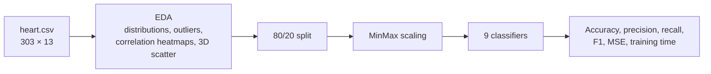

# Heart Attack Risk Prediction with Machine Learning

Exploratory data analysis and a benchmark of nine classifiers for predicting heart-attack risk from 13 clinical attributes, with accuracy, precision, recall, F1, error and training time reported for each model.

This was my machine-learning coursework project. The write-up is available as a research paper on [ResearchGate](https://www.researchgate.net/publication/357255330_Recognize_the_Most_Effective_Exploratory_Data_Analysis_and_Machine_Learning_Methods_for_Predicting_the_Chances_of_Having_a_Heart_Attack).

> Educational project on a small public dataset. Not a diagnostic tool.

## Data

- [`heart.csv`](heart.csv): **303 patients**, 13 features and a binary target `output` (1 = higher chance of heart attack). Features: `age`, `sex`, chest-pain type (`cp`), resting blood pressure (`trtbps`), cholesterol (`chol`), fasting blood sugar (`fbs`), resting ECG (`restecg`), maximum heart rate (`thalachh`), exercise-induced angina (`exng`), ST depression (`oldpeak`), slope (`slp`), number of major vessels (`caa`), thalassemia (`thall`).
- [`o2Saturation.csv`](o2Saturation.csv): companion oxygen-saturation readings from the same Kaggle dataset (explored in EDA only).

## Method



Models (scikit-learn and XGBoost): Logistic Regression, KNN (k = 15), SVM (RBF), Decision Tree, Random Forest (300 trees), AdaBoost, Gradient Boosting, XGBoost and an MLP (150-100-50).

## Results

Held-out test set of 61 patients, as saved in [`heart attack prediction preprocess and model run.ipynb`](heart%20attack%20prediction%20preprocess%20and%20model%20run.ipynb):

| Model | Accuracy | Precision | Recall | F1 |
|---|---:|---:|---:|---:|
| XGBoost | **95.08%** | 0.968 | 0.938 | 0.952 |
| AdaBoost | 93.44% | 0.967 | 0.906 | 0.935 |
| MLP | 93.44% | 0.938 | 0.938 | 0.938 |
| Random Forest | 91.80% | 0.935 | 0.906 | 0.921 |
| Gradient Boosting | 91.80% | 0.966 | 0.875 | 0.918 |
| Logistic Regression | 90.16% | 0.882 | 0.938 | 0.909 |
| SVM | 90.16% | 0.882 | 0.938 | 0.909 |
| KNN | 88.52% | 0.879 | 0.906 | 0.892 |
| Decision Tree | 81.97% | 0.818 | 0.844 | 0.831 |


Confusion matrices for every model are in [`OutPut Image Of the Machine Learning Model/`](OutPut%20Image%20Of%20the%20Machine%20Learning%20Model).

## Repository structure

```text
├── Heart_attack_3_EDA.ipynb                                  # Exploratory analysis
├── heart attack prediction preprocess and model run.ipynb    # Preprocessing, training, evaluation
├── Heart attack prediction notebook.ipynb                    # Earlier combined notebook
├── heart.csv, o2Saturation.csv                               # Data
├── OutPut Image Of the Machine Learning Model/               # Charts and confusion matrices
├── Heart attack prediction work progress.docx                # Progress report
└── LICENSE
```

## Running the notebooks

```bash
git clone https://github.com/hasansust32/Heart_Attack_Predic_Using_Machine_Learning_Algorithm.git
cd Heart_Attack_Predic_Using_Machine_Learning_Algorithm
python -m venv .venv && source .venv/bin/activate
pip install jupyter pandas numpy scikit-learn xgboost matplotlib seaborn plotly
jupyter notebook
```

Notebooks may reference Kaggle input paths; point them at the CSV files in the repository root. Newer scikit-learn versions renamed Gradient Boosting's `loss="deviance"` to `loss="log_loss"`.

## Limitations

- **Test-set selection.** The notebook includes a loop (`checkRS`) that tries many train/test split seeds and reports the best accuracy. Choosing a split by its test score makes the headline numbers optimistic; cross-validation would give a fairer estimate.
- Only 61 test patients, so a single patient moves accuracy by about 1.6 points.
- No external validation.

## Licence

[MIT](LICENSE)

## Author

**S M Mahamudul Hasan** · [GitHub](https://github.com/hasansust32) · [Portfolio](https://www.hasansm.com/) · [LinkedIn](https://www.linkedin.com/in/sm-mahamudul-hasan/)
